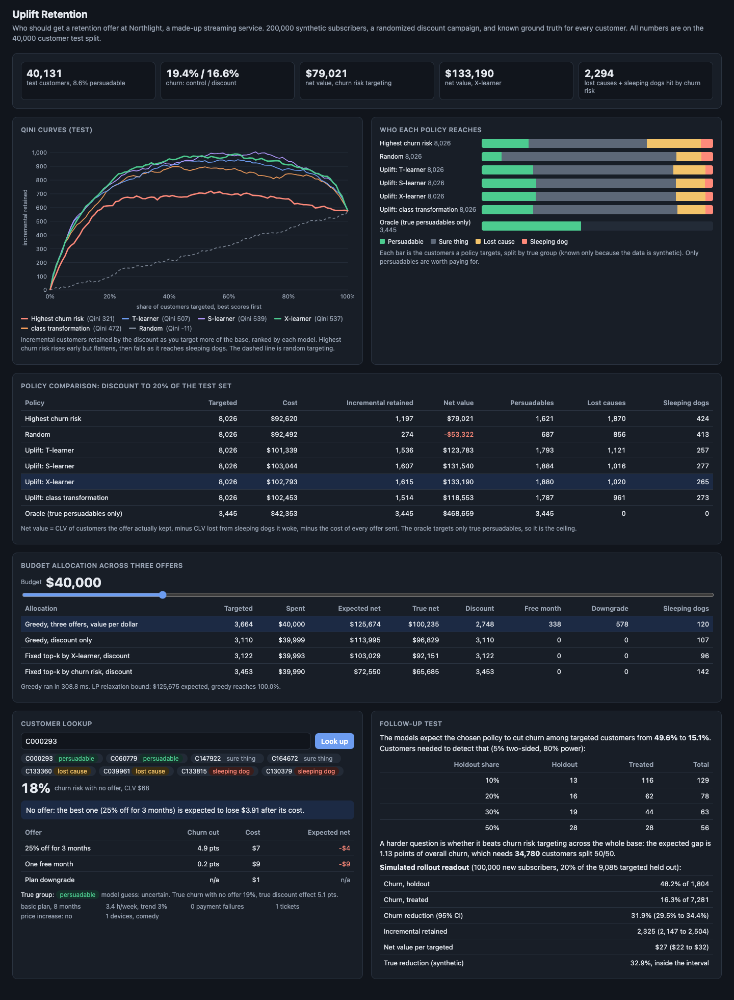

# Uplift Retention

Retention targeting for Northlight, a made-up subscription streaming service. It shows why "target the customers most likely to churn" is the wrong question, and how uplift modeling picks who should get an offer instead. 200,000 synthetic subscribers come with a known causal structure and a randomized historical discount campaign, so every model and policy can be scored against the truth. Four uplift learners are compared on Qini curves and on true dollars, a budget allocator spreads spend across three offer types, and an experiment design module sizes the follow-up test and reads out a simulated rollout. A FastAPI service scores customers and serves the dashboard.



## Results

Test split: 40,131 customers the models never saw. Each policy sends the discount (25% off for 3 months) to 20% of them. Net value is measured on the true potential outcomes: CLV of customers the offer actually kept, minus CLV lost from customers it pushed out, minus the cost of every offer sent.

| Policy | Targeted | Cost | Incremental retained | Net value | Persuadables | Lost causes | Sleeping dogs |
|---|---:|---:|---:|---:|---:|---:|---:|
| Highest churn risk | 8,026 | $92,620 | 1,197 | $79,021 | 1,621 | 1,870 | 424 |
| Random | 8,026 | $92,492 | 274 | -$53,322 | 687 | 856 | 413 |
| Uplift: T-learner | 8,026 | $101,339 | 1,536 | $123,783 | 1,793 | 1,121 | 257 |
| Uplift: S-learner | 8,026 | $103,044 | 1,607 | $131,540 | 1,884 | 1,016 | 277 |
| **Uplift: X-learner** | 8,026 | $102,793 | **1,615** | **$133,190** | 1,880 | 1,020 | 265 |
| Uplift: class transformation | 8,026 | $102,453 | 1,514 | $118,553 | 1,787 | 961 | 273 |
| Oracle (true persuadables only) | 3,445 | $42,353 | 3,445 | $468,659 | 3,445 | 0 | 0 |

Same budget, same offer, same number of customers. The X-learner keeps 35% more customers than churn risk targeting (1,615 vs 1,197) and returns 69% more net value ($133k vs $79k). Churn risk targeting spends on 1,870 lost causes, who leave anyway, and wakes 424 sleeping dogs, who would have stayed. The oracle row is the ceiling: most of the remaining gap is noise no model can remove, since outcomes are coin flips even given the features.

Qini coefficients on test (area between the Qini curve and random targeting): X-learner 537, S-learner 539, T-learner 507, class transformation 472, churn risk 321, random -11. The X-learner had the best validation Qini, so it is the champion the API uses. In the uplift-by-decile table its top decile shows a 26.3 point observed churn reduction (true 27.1), against 19.9 for the top churn risk decile. The full numbers are in [reports/summary.md](reports/summary.md) and [reports/eval.json](reports/eval.json).

**Budget allocation, $40,000** (the slider in the UI re-runs this):

| Allocation | Targeted | Expected net | True net |
|---|---:|---:|---:|
| Greedy across three offers (2,748 discount, 338 free month, 578 downgrade) | 3,664 | $125,674 | $100,235 |
| Greedy, discount only | 3,110 | $113,995 | $96,829 |
| Fixed top-k by X-learner, discount | 3,122 | $103,029 | $92,151 |
| Fixed top-k by churn risk, discount | 3,453 | $72,550 | $65,685 |

The greedy allocation reaches 100.0% of the LP relaxation bound ($125,675), so on this data there is nothing left on the table from the algorithm itself. Expected value runs ahead of true value for every allocation that optimizes on model estimates. That is the winner's curse: picking the highest estimates also picks the most overestimated ones.

**Follow-up test.** The chosen policy expects targeted churn to drop from 49.6% to 15.1%. With a 20% holdout that needs only 78 customers, so the policy's own effect is easy to confirm. The harder question is whether it beats churn risk targeting across the whole base: the expected gap is 1.13 points of overall churn, which needs 34,780 customers split 50/50. On a simulated rollout to 100,000 new subscribers, 1,804 held out: churn reduction 31.9% (95% CI 29.5% to 34.4%), true value 32.9%, inside the interval; net value $27 per targeted customer ($22 to $32).

## The four groups

Every subscriber falls in exactly one group for a given offer, and you can never observe which one, because nobody can both get and not get the offer.

- **Persuadables** would cancel without the offer and stay with it. These are the only customers worth paying for. 8.6% of the base.
- **Sure things** stay either way. An offer to them is pure cost. 75% of the base.
- **Lost causes** leave either way, often because they stopped watching or their card keeps failing. They have the highest churn risk, which is exactly why churn models send them offers. 10.9%.
- **Sleeping dogs** stay only as long as nobody reminds them they pay: long tenure, low usage, stable. The offer email makes them cancel. 5.3%.

A churn model ranks persuadables and lost causes together at the top, because both would churn. An uplift model ranks by the difference the offer makes, which separates them and pushes sleeping dogs to the bottom.

## Why

Most retention programs score churn risk and send offers to the top of the list. It feels right, it is easy to explain, and it is the wrong objective: it pays for customers who were leaving anyway and annoys customers who were staying. The question that matters is causal ("what changes if we send this?"), and answering it needs randomized history and models built for treatment effects. Then the budget has to be spread across offers with different costs, and the result has to be proven with a holdout before anyone trusts it. This repo is a small working version of that whole loop.

## Architecture

```
 generator (seeded)                 learners (scikit-learn HGB)        evaluation                     serving
 ┌────────────────────────────┐    ┌──────────────────────────┐    ┌─────────────────────────┐    ┌────────────────────────┐
 │ 200,000 subscribers        │    │ churn propensity         │    │ Qini + uplift curves,   │    │ FastAPI                │
 │ 11 features                │    │ T-, S-, X-learner,       │    │ areas, deciles          │    │ /api/score             │
 │ hidden p0, save, trigger   │───▶│ class transformation     │───▶│ true policy value from  │───▶│ /api/policy/evaluate   │
 │ per offer -> 4 groups      │    │ multi-offer T-learner    │    │ potential outcomes      │    │ /api/budget            │
 │ discount to random 50%     │    │ (main + 3 offer pilot)   │    │ budget: greedy + LP     │    │ /healthz, /metrics     │
 │ pilot: 100,000, 4 arms     │    └──────────────────────────┘    │ power + rollout readout │    │ plain HTML/JS UI       │
 └────────────────────────────┘     train 60 / valid 20 / test 20  └─────────────────────────┘    └────────────────────────┘
```

| Piece | File |
|---|---|
| Synthetic subscribers, causal structure, four groups | [src/uplift/generator.py](src/uplift/generator.py) |
| Plans, offers, costs, CLV model | [src/uplift/offers.py](src/uplift/offers.py) |
| Churn model and the four uplift learners | [src/uplift/learners.py](src/uplift/learners.py) |
| Qini and uplift curves, areas, deciles | [src/uplift/evaluation.py](src/uplift/evaluation.py) |
| Policy value math | [src/uplift/policy.py](src/uplift/policy.py) |
| Budget allocation, LP bound, exact check | [src/uplift/budget.py](src/uplift/budget.py) |
| Power analysis and readout | [src/uplift/experiment.py](src/uplift/experiment.py) |
| End to end study | [src/uplift/pipeline.py](src/uplift/pipeline.py) |
| API, JSON logs, Prometheus metrics, UI | [src/uplift/app.py](src/uplift/app.py), [logs.py](src/uplift/logs.py), [metrics.py](src/uplift/metrics.py), [static/index.html](src/uplift/static/index.html) |

**Causal structure.** Each subscriber has a churn probability with no offer, p0(x), driven by payment failures, falling usage, support tickets, a recent price increase, low viewing hours, and short tenure. If they would churn, each offer saves them with its own probability; if they would stay, each offer triggers churn with its own probability. Shared random draws per customer keep the offers consistent. The discount works on price-sensitive customers and deal seekers, the free month on lapsing viewers, the downgrade on customers whose payments fail. Sleeping dogs are long-tenure, low-usage subscribers.

**Learners.** Uplift is churn probability without the offer minus with it.
- *T-learner*: one model per arm, take the difference. Simple, but each model only sees half the data.
- *S-learner*: one model with the treatment flag as a feature. Uses all the data, but trees can ignore the flag and shrink effects toward zero. Here it did fine because effects are large.
- *X-learner*: fit the T-learner's two models, impute each customer's individual effect using the other arm's model, regress those imputed effects on the features, and blend. Usually the best when effects are smaller than outcomes.
- *Class transformation*: with a 50/50 randomized split, define Z = 1 for (treated and stayed) or (control and churned). Then uplift = 2 P(Z=1 | x) - 1, so one ordinary classifier does the job. It is the noisiest of the four.

**CLV model.** Monthly margin is 50% of the plan price ($8.99, $15.49, $22.99). Expected remaining months are 12 + 0.4 x tenure, capped at 36. CLV is margin times remaining months. A customer kept by a downgrade is valued at the cheaper plan's price. Offer costs: discount 75% of one month's price, free month one month's price, downgrade nothing beyond lost margin, plus $0.50 to contact anyone.

**Budget allocation.** Each customer gets at most one offer and spend must stay within budget: a multiple-choice knapsack. Ranking every (customer, offer) pair by value per dollar does not work, because a near-free offer with a small value locks the customer out of a better one (a test shows the trap). The allocator instead builds each customer's ladder of upgrades along the convex hull of (cost, value), sorts all steps by extra value per extra dollar, and applies them while they fit. It runs in about 0.3 seconds on 40,000 customers. A linear program relaxation with scipy HiGHS gives an upper bound, and `scipy.optimize.milp` gives the exact optimum on small cases in the tests. scipy ships with scikit-learn, but the LP check is skipped (greedy only, and the UI says so) if it is missing.

**Experiment design.** Sample size uses the two-proportion normal approximation with pooled variance under the null and allows any holdout share. The readout reports churn rates, the difference with a Wald interval, a pooled z test, incremental retained customers, and net value per targeted customer with an interval.

## How to run

```bash
cd uplift-retention
uv sync --python 3.12
make eval          # full study (about 30 s), writes reports/ and caches data/study.pkl
make run           # API and UI on http://127.0.0.1:8830
```

Without the cache, `make run` trains on first start and saves `data/study.pkl` (set `UPLIFT_STUDY` to move it, `UPLIFT_N` to change the size).

```bash
curl localhost:8830/healthz
curl -X POST localhost:8830/api/score -H 'content-type: application/json' -d '{"tenure_months":8,"plan":"premium",
  "price_increase":1,"weekly_hours":6.5,"usage_trend":-0.1,"support_tickets":1,"payment_failures":0,
  "primary_genre":"drama","genre_count":3,"device_count":2,"promo_history":1}'
# -> churn_risk 0.22, uplift per offer, action "discount": "expected to cut churn risk by 18.2 points, worth $14.01 after its $17.74 cost."
curl -X POST localhost:8830/api/policy/evaluate -H 'content-type: application/json' -d '{"policy":"churn_risk","share":0.1}'
curl "localhost:8830/api/budget?amount=80000&lp=true"
curl localhost:8830/api/customers/sample        # two test customers per true group
curl localhost:8830/metrics
```

`make gate` runs the same study and exits 1 unless the best uplift policy's true net value beats churn risk targeting. CI runs it on every push.

Docker is not installed on the development machine, so the `Dockerfile` (multi-stage, non-root, HEALTHCHECK) is built and smoke tested in GitHub Actions only. Everything runs without it through `uv`.

## Tests

127 tests, about 10 seconds: `make test`.

- Generator: every customer in exactly one group and the groups match the potential outcomes, observed churn equals the assigned arm's outcome, randomization balance (treated share and standardized mean difference under 0.03 for every feature), seeding, plausible group shares, downgrade has no effect on Basic, the feature matrix never reads ground truth.
- Learners: each of the four on a tiny dataset with a known effect (0.4 where x0 > 0, none elsewhere) recovers the effect, finds no effect where there is none, ranks treatable customers first, and detects a sleeping dog segment; the churn model trains on control only; the multi-offer model recovers per-arm effects.
- Qini against a hand-worked six-customer example (curve, uplift curve, areas, coefficient 2/3), perfect vs random vs reversed ranking, deciles.
- Policy value math on four customers, one per group, worked by hand; CLV and offer costs.
- Budget: exact MILP equals brute force on random cases, greedy is feasible and bounded by brute force and the LP, greedy is optimal on a worked case, the cheap-offer trap, budgets respected.
- Power analysis against the textbook value (0.50 vs 0.60, 388 per group), achieved power at the planned size, readout against a hand-computed interval and p-value, interval coverage near 95%.
- Pipeline and API end to end on a 30,000 customer study: uplift beats churn risk, the oracle is pure persuadables, the gate passes and fails correctly, scoring, lookup, validation errors, request ids, and metrics.

## Production notes

- **Data.** The campaign history would come from a warehouse table of offers sent, with a real randomized holdout kept on every campaign. Without randomization, treatment effects are not identifiable from history and you need propensity weighting and much more care.
- **Retraining and drift.** Uplift models go stale as offers, prices, and the catalog change. Every campaign keeps a small random holdout, so each one is also fresh training data and a live check on the model's predicted lift.
- **Scoring.** Batch score the base nightly into a feature store and allocate the budget per campaign. The online endpoint here is for single lookups and agent tooling.
- **Allocation constraints.** Real programs add contact frequency caps, offer eligibility rules, channel capacity, and fairness checks across customer segments. Those become extra LP constraints; the greedy stays as the fast default when the LP gap is small.
- **Measuring value.** The readout here uses known CLV. In practice you measure retained revenue over 3 to 6 months and update the CLV model from it.

## License

MIT. See [LICENSE](LICENSE).
